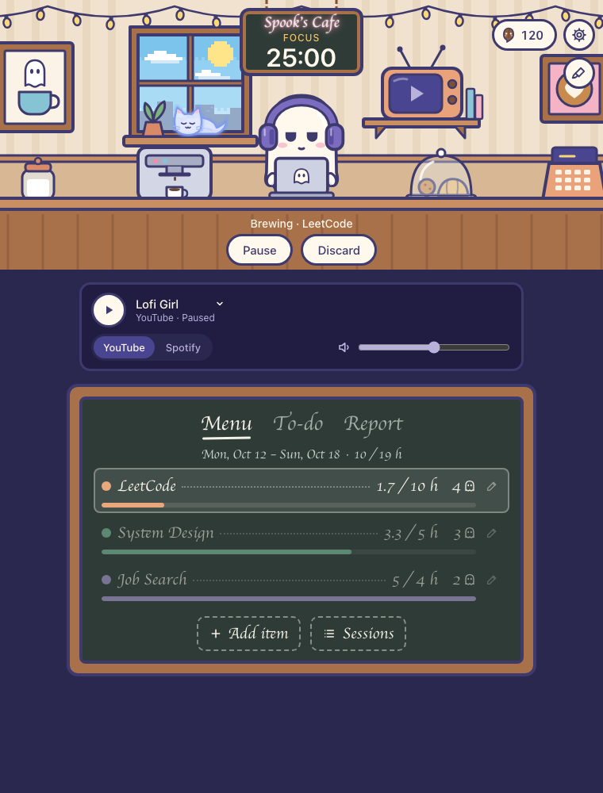
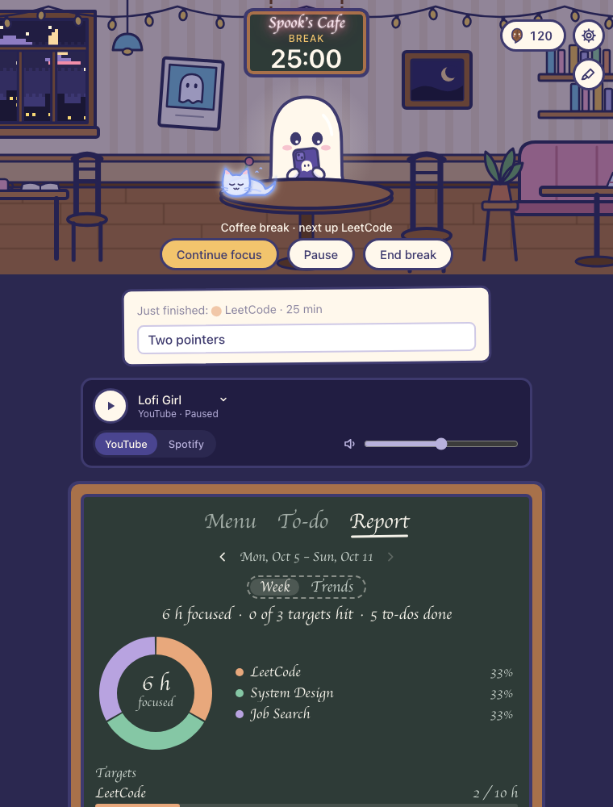
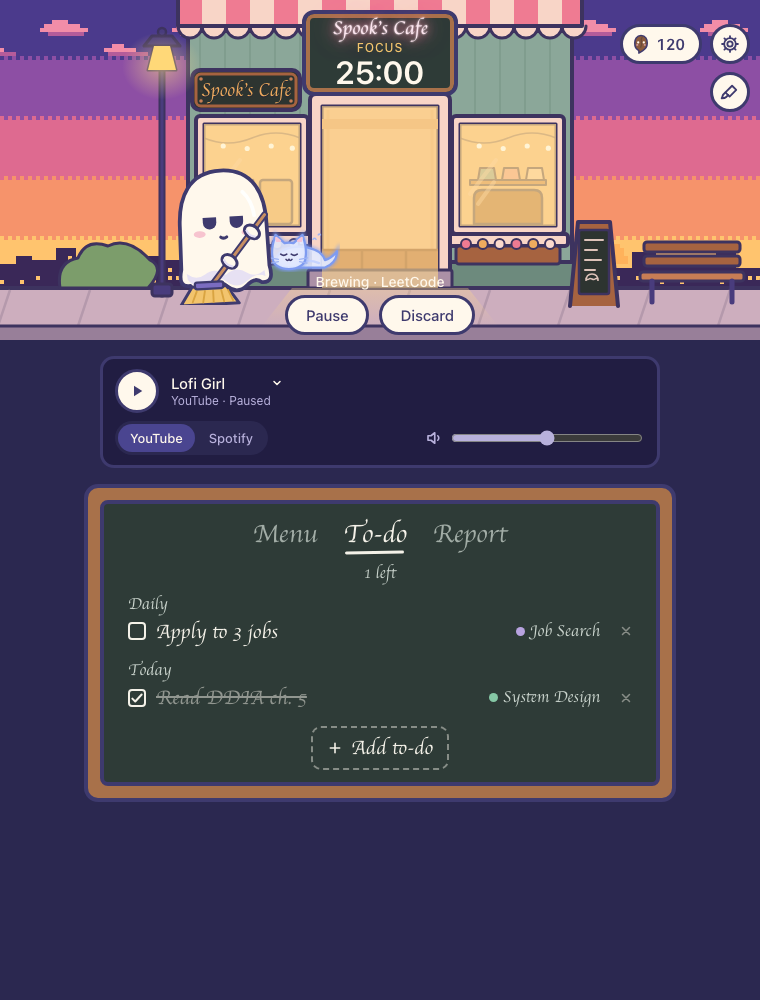
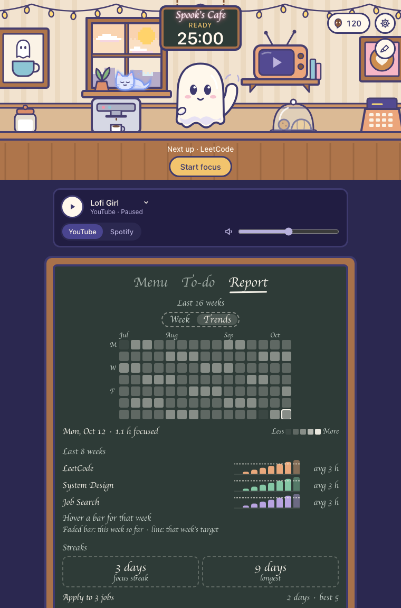

# Spook's Cafe

A macOS Pomodoro tracker with a lofi cafe run by Spook, a little sheet ghost. Spook types on his laptop while you focus, sips coffee on your breaks and dozes when you pause. The cafe's light follows the time of day, and music plays from YouTube or Spotify.

I built it to structure a full-time job search (LeetCode, system design, applications) around weekly hour targets. It's become a passion project.

| Counter, focusing | Tables, on a break at night |
|---|---|
|  |  |
| **Outside, evening, sweeping the pavement** | **Report → Trends** |
|  |  |

<sub>Screenshots are of the real components rendered with sample data.</sub>

## What it does

**Timer**
- Pick a task and start a focus block (25 / 5 / 15 by default, with per-task overrides). Breaks start on their own; the next focus waits for a click.
- The task is locked during focus. Pause logs nothing; Discard logs the partial minutes.
- Lives in the menu bar too: a Spook icon with the countdown, plus a menu to start, pause or switch tasks without opening the window.
- Survives sleep, quit and crashes: the timer is saved every few seconds and comes back paused where it stopped.
- When a phase ends: a macOS notification and a soft chime (the chime can be turned off).

**Tasks and progress**
- Weekly hour targets per task, with progress bars on a chalkboard menu.
- Edit tasks (rename, recolour, archive, target, timer overrides). Edit or delete logged sessions.
- An optional note on each session, asked for during the break that follows.
- Export everything to JSON or CSV.

**To-do list**
- One-time and daily to-dos, optionally tagged with a task. Dailies come back unticked at midnight, and every tick is kept for reporting.

**Reports**
- **Week**: hours per task (a donut chart), targets hit, to-dos done and daily habit dots. Steps back through past weeks.
- **Trends**: a 16-week heatmap, 8 weeks of bars per task against their targets, focus and habit streaks, and insights (best weekday, most focused hour, completion rate).

**The cafe**
- Three scenes to switch between: outside, the counter and the tables. Spook has his own poses for each.
- Four times of day (morning, afternoon, evening, night) with a pixel-art sky and city. Their hours are adjustable, or you can pin one.
- Mochi, a ghost cat, naps in every scene.
- **Boo Beans**: earned from completed focus blocks, ticked to-dos and weekly targets met. Spend them on hats for Spook and decorations for the cafe.

**Music**
- **YouTube**: Lofi Girl, Chillhop or any channel or link, in a hidden player window. The cafe TV shows the station's artwork. Signing in once gives ad-free YouTube Premium.
- **Spotify**: remote-controls the Spotify desktop app (play/pause, skip, volume, now playing, an optional playlist link).

## Setup

### Prerequisites
- **macOS.** The app uses macOS-only pieces: AppleScript for Spotify, `afplay` for the chime and App Nap control.
- **Xcode Command Line Tools**: `xcode-select --install`
- **Rust** (stable) via [rustup](https://rustup.rs)
- **Node.js** 20.19 or newer
- Optional: the **Spotify** desktop app, to use it as the music source

### Run in development

```sh
npm install
npm run tauri dev
```

The first run compiles the Rust side, which takes a few minutes; later runs are quick. For a quick demo, make minutes run as seconds so a whole focus block takes 25 s:

```sh
LOFI_FAST=1 npm run tauri dev
```

### Build the app

```sh
npm run tauri build
```

The app lands in `src-tauri/target/release/bundle/macos/Spook's Cafe.app`, with a `.dmg` next to it under `bundle/dmg/`.

### Permissions macOS asks for
- **Notifications**: on the first phase end. In dev, notifications appear as coming from Terminal; the built app asks under its own name.
- **Automation → Spotify**: the first time Spotify is used. In dev this is attributed to whichever app launched it (e.g. Visual Studio Code).
- **YouTube sign-in** is optional: Settings → Sign in to YouTube, once, for Premium.

### Where data lives
- SQLite database in `~/Library/Application Support/Lofi Focus/`: `lofi-focus.db` for the built app, and a separate `lofi-focus-dev.db` for `tauri dev`, so experiments never touch real data. (The folder keeps the app's original name on purpose.)
- Schema changes are numbered migrations in `src-tauri/migrations/`, applied on launch.
- Exports go to `~/Downloads`.

### Handy scripts (dev database only)

| Command | What it does |
|---|---|
| `npm run db:clear-sessions` | Deletes all sessions, e.g. the fake ones `LOFI_FAST` logs |
| `npm run db:grant-beans` | Adds 1000 beans for trying the shop |

### Tests

```sh
cd src-tauri && cargo test
```

59 tests cover the Rust core: the timer, migrations, weekly and report queries (including week and midnight boundaries), to-dos and the bean ledger.

## How it's built

**Stack:** Tauri 2 (Rust) · React 19 + TypeScript (Vite) · SQLite (rusqlite)

**Rust owns the state; React draws it.** The timer, database, music and menu bar all live in Rust.
- React calls Rust **commands** (`invoke("start_focus", …)`) to change things.
- Rust pushes **events** (`"timer"`, `"music"`, `"shop"`) back to React to keep it in sync.
- So the menu bar and the window can never disagree, and the timer keeps running when the window is closed.

```
src/                    React UI
  cafe/                 the scene, Spook, chalkboard sections, shop
  use*.ts               hooks that wrap commands and events (useTimer, useMusic, …)
src-tauri/src/          Rust core
  timer.rs, timer/      timer engine and persistence
  db.rs, migrations/    SQLite and numbered migrations
  tray.rs, alerts.rs    menu bar, notifications and chime
  music/                hidden YouTube window and Spotify via AppleScript
  report.rs, shop.rs    reporting queries, bean ledger and shop
design/                 Node scripts that generate the SVG art into src/assets/
docs/                   research notes and screenshots
```

All the art (Spook, the scenes, hats and decorations) is SVG generated by code in `design/`. Rebuild it with `node design/<spook|cafe|shop>/build.mjs`; never hand-edit the generated files.

## Project docs
- [`SPEC.md`](SPEC.md): requirements, design decisions and build order
- [`DEFECTS.md`](DEFECTS.md): known bugs and rough edges
- [`docs/youtube-spike.md`](docs/youtube-spike.md): why YouTube plays in a hidden window instead of an iframe

## Status
- **Built:** timer, tasks, settings, music, the cafe look with three scenes, to-dos, reports and the shop.
- **Next:** polishing items in `DEFECTS.md` (Mochi's art, keyboard and reflow passes), then decorating and more poses.
