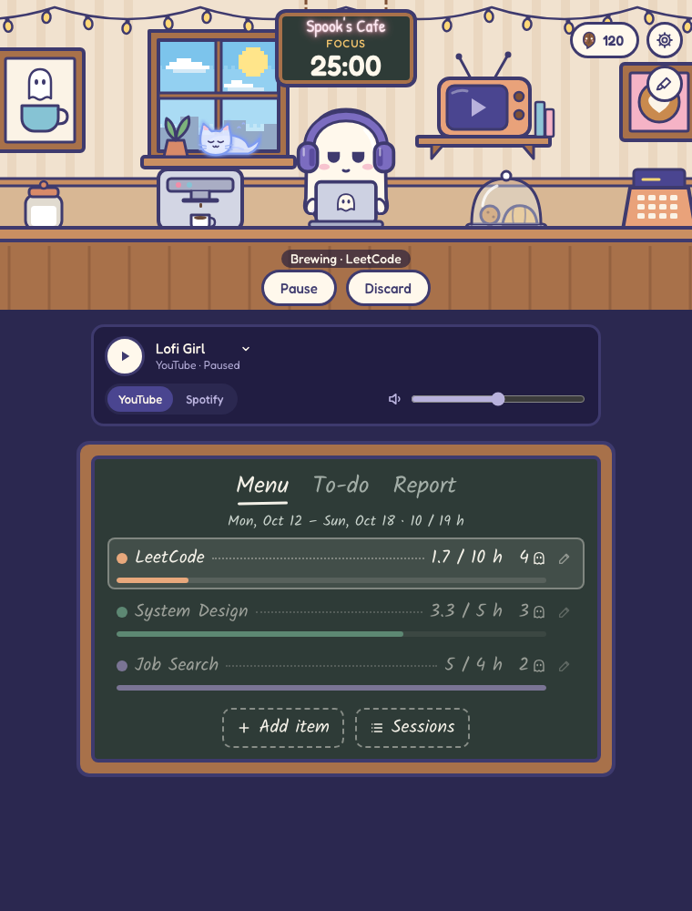
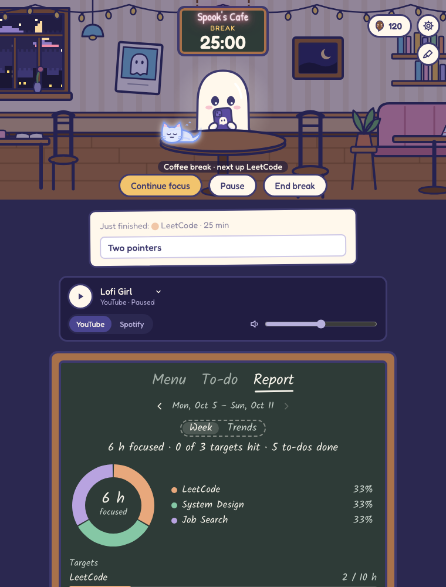
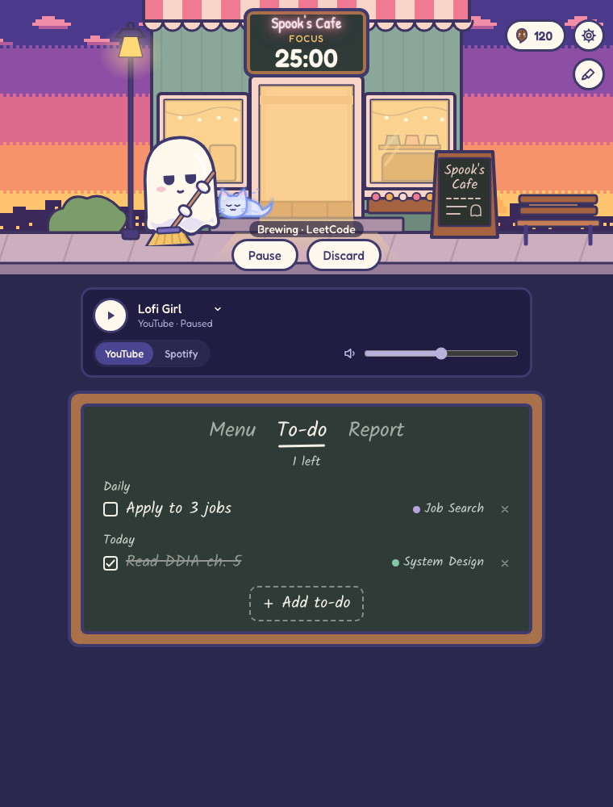
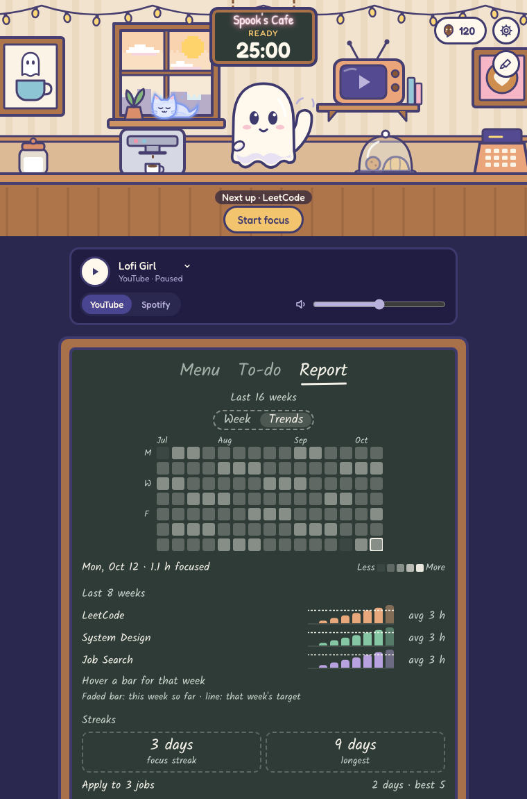

# Spook's Cafe

A macOS Pomodoro tracker with a lofi cafe run by Spook, a little sheet ghost. Spook types on his laptop while you focus, sips coffee on your breaks and dozes when you pause. The cafe's light follows the time of day, and music plays from YouTube or Spotify.

I built it to structure a full-time job search (LeetCode, system design, applications) around weekly hour targets. It's become a passion project.

| Counter, focusing | Tables, on a break at night |
|---|---|
|  |  |
| **Outside, evening, sweeping the pavement** | **Report → Trends** |
|  |  |

<sub>Screenshots are of the real components rendered with sample data.</sub>

**Built with:** Tauri 2 (Rust) · React 19 + TypeScript · SQLite

## Highlights

- **Focus timer with weekly hour targets** per task, a menu-bar countdown, and notifications when a phase ends. It survives sleep, quit and crashes and comes back paused where it stopped.
- **Reports:** a weekly breakdown, plus a 16-week heatmap, streaks and insights such as your most focused hour.
- **A living cafe:** three scenes, four times of day, Spook's poses, and a shop where focus earns Boo Beans to spend on hats and decorations. All the art is SVG generated by code.
- **Music** from YouTube (in a hidden player window) or the Spotify desktop app.
- **Rust owns the state, React draws it.** The timer, database, music and menu bar live in Rust and push events to the UI, so the menu bar and the window never disagree and the timer keeps running with the window closed. 59 Rust tests cover the core, including week and midnight boundaries.

## Run it

Needs macOS, Xcode Command Line Tools, Rust and Node.js 20.19+.

```sh
npm install
npm run tauri dev
```

Setup, building and installing, where data lives, the code layout and the full feature list are in the **[guide](docs/guide.md)**.
